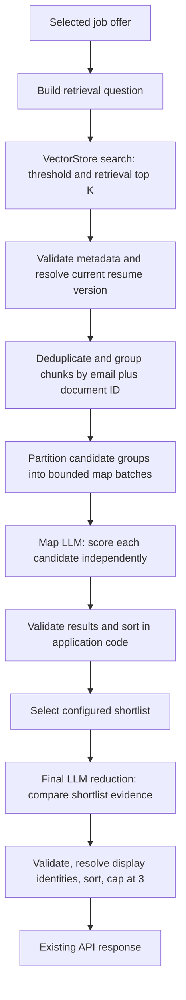

# Technical Design: MapReduce and Tiered Candidate Ranking

- **Status:** [ ] Draft | [x] Approved for Implementation
- **Author/Agent:** @architect
- **Date:** 2026-10-20
- **Reference Spec:** `01-requirements.md`

## 1. Architecture

Keep the existing API and `CandidateMatchingService` orchestration boundary. Replace the current
single retrieval-augmented ranking call in `OpenAiCandidateRanker` with a staged pipeline backed by
the existing `VectorStore`, `ResumeRepository`, and configured `ChatClient`.

Proposed components:

- `CandidateMatchingPipelineProperties`: validated limits for retrieval, map batching, shortlist,
  result count, and concurrency.
- `CandidateResumeRetriever`: runs one offer-specific Vector Store search and normalizes retrieved
  chunks, preserving their IDs, text, metadata, and similarity ordering where available.
- `CandidateEvidenceAssembler`: validates metadata, resolves the current resume version through
  `ResumeRepository`, discards stale chunks, deduplicates chunks, and groups evidence by normalized
  candidate email plus current document ID.
- `CandidateMapEvaluator`: submits bounded groups of candidate evidence to the map prompt and
  parses structured per-candidate scores and evidence references.
- `CandidateRankingPipeline`: sequences retrieval, assembly, bounded map execution, application
  sorting, shortlist selection, final reduction, and validation.
- `OpenAiCandidateRanker`: delegates its `rank(offer)` operation to the pipeline and translates
  validated final results to the existing ranker result type.

Do not run one LLM request over the entire candidate pool. Map batches may execute with bounded
concurrency. Wait for all required batches; a failed batch fails the whole matching request. The
final reduce call runs once and receives only the shortlist.

## 2. Retrieval and Evidence Assembly

Build the retrieval question from all job offer criteria specified in the requirements: job name,
description, required qualifications, responsibilities, nice-to-have criteria, location, and
allocation/working mode. Use a `SearchRequest` against the existing `VectorStore`, applying the
configured inclusive similarity threshold and retrieval pool size. Retrieval pool size is a
document/chunk limit, not a candidate count.

For every returned chunk:

1. Read `candidateEmail` and `documentId` from its Vector Store metadata. Do not infer either value
   from text or an LLM response.
2. Normalize email for lookup and grouping while preserving the repository's stored display value.
3. Resolve the current `ResumeDocument` by email. Keep the chunk only if its metadata document ID
   equals the current record's document ID.
4. Deduplicate by Vector Store document ID. Preserve the chunk ID as the evidence reference.
5. Group remaining chunks by candidate email and current document ID. Candidate name and display
   email come from `ResumeDocument`, not from generated model content.

If no eligible candidate groups remain, return an empty list without invoking either model stage.
Invalid/stale chunk metadata is excluded and logged only as aggregate counts; do not log resume
text, names, or email addresses.

The existing upload flow writes `candidateEmail`, `documentId`, and `fileName` metadata and stores
the current document ID in `ResumeDocument`. The pipeline uses that established version relationship
and does not change upload/indexing behavior.

## 3. Map Stage

Partition candidate evidence groups into batches using the configured map batch size. A candidate
group is the unit of evaluation; its retrieved chunks are combined into a candidate-specific
evidence payload with stable chunk IDs. Chunk text is deduplicated before inclusion. Each map
request
contains the offer criteria and one batch, and instructs the model to score each candidate
independently without comparing candidates within the batch.

Map prompt and response are separate from final ranking:

- Store the map prompt in a classpath resource, configurable through
  `candidate.matching.map-prompt-file`.
- Use structured output containing candidate email, map score, matched skills, relevant experience,
  and supporting chunk IDs.
- Define map score as a numeric integer on a `0..100` scale. The score orders candidates for
  shortlist selection and is never returned by the API.
- Validate that every returned email and evidence reference belongs to the batch input, each input
  candidate has exactly one result, required fields are present, score is finite and within
  `0..100`, and each cited chunk was supplied for that candidate.
- Discard individual matched-skill or experience claims if their text is blank or their chunk quote
  cannot be validated by exact word and punctuation sequence, allowing whitespace-only
  normalization for PDF line wrapping. Continue to reject invalid identities, scores, and required
  score evidence; never pass unsupported optional claims downstream as supported.
- Discard individual matched-skill or experience claims if their text is blank or their chunk quote
  cannot be validated exactly. Continue to reject invalid identities, scores, and required score
  evidence; never pass unsupported optional claims downstream as supported.
- If a batch is malformed or fails, fail the full ranking operation. Do not continue with a partial
  pool.

Execute map batches through a bounded executor with configured maximum concurrency. Preserve stable
batch/result association and collect results only after all batches succeed.

## 4. Reduce, Shortlist, and Final Ranking

Aggregate accepted map results by normalized candidate email. Since assembly produces one group per
candidate/version, duplicates at this point indicate repeated output; reject conflicting duplicate
results and collapse identical duplicates. Sort by map score descending, then normalized email
ascending for ties. Select the first configured shortlist-size candidates.

The final prompt is stored separately in a classpath resource configurable through
`candidate.matching.final-ranking-prompt-file`. Its input contains the offer criteria and only the
shortlisted candidates. For each shortlisted candidate, include all eligible retrieved chunks from
the retrieval stage, not merely the map-stage summary, so final synthesis can use the complete
available retrieved evidence. Do not reload or expose whole resume files outside the Vector Store
evidence returned for this request.

The final response retains current matching fields and includes internal evidence references for
validation. Validate that returned candidates are in the shortlist, supporting references belong to
their retrieved evidence, matched skills and work experiences are supported by cited text using
exact word/punctuation sequence (whitespace-only normalization allowed), and probability is finite
and within `[0,1]`. Resolve candidate name and email from the current
`ResumeDocument`. Sort by final probability descending, break ties by normalized email ascending,
deduplicate by email, assign one-based positions, and cap the result at the configured result limit
(maximum three). Map scores never become matching probabilities.

If there are eligible candidates but fewer than the shortlist size, run final reduction on the
available candidates. If the shortlist is empty, do not call the final model.

## 5. Configuration

Add validated `candidate.matching.pipeline` properties with defaults sized for resumes up to
20,000 characters. Three-candidate map and final requests stay bounded by the 24,000-character
per-candidate evidence budget.

| Property                                       |                                Proposed default | Purpose                                         |
|------------------------------------------------|------------------------------------------------:|-------------------------------------------------|
| `candidate.matching.pipeline.retrieval-top-k`  |                                           `120` | Maximum retrieved resume chunks                 |
| `candidate.matching.pipeline.map-batch-size`   |                                             `3` | Candidate groups per map request                |
| `candidate.matching.pipeline.shortlist-size`   |                                             `3` | Candidate groups passed to final reduction      |
| `candidate.matching.pipeline.result-limit`     |                                             `3` | Maximum API results; values above 3 are invalid |
| `candidate.matching.pipeline.max-concurrency`  |                                             `2` | Maximum simultaneous map requests               |
| `candidate.matching.pipeline.max-evidence-chars-per-candidate` | `24000` | Complete retrieved evidence limit per candidate |
| `candidate.matching.map-prompt-file`           |   `classpath:prompts/candidate-ranking-map.txt` | Map-stage prompt resource                       |
| `candidate.matching.final-ranking-prompt-file` | `classpath:prompts/candidate-ranking-final.txt` | Final-stage prompt resource                     |

The 24,000-character evidence default accommodates a complete 20,000-character resume with modest
headroom. Requests exceeding the evidence limit fail visibly; evidence is not silently truncated.
Three candidates per map request and a three-candidate final shortlist cap worst-case resume content
at about 72,000 characters per model request before prompt/JSON overhead. All integer limits must
be positive. Enforce safe upper bounds for retrieval top K, batch size, shortlist size, evidence
characters, and concurrency to prevent accidental unbounded requests. Keep the existing
`candidate.matching.similarity-threshold` for
Vector Store eligibility. Preserve existing model configuration unless a stage-specific model
selection is explicitly approved.

The existing `candidate.matching.top-k` remains at its legacy default of `10` for compatibility,
but the staged pipeline ignores it. Only `candidate.matching.pipeline.retrieval-top-k` controls the
new retrieval pool, so two settings cannot silently control the same request.

## 6. API, Data, and Trust Boundaries

- Keep `POST /api/candidate-matches` request and response schemas unchanged.
- Continue returning candidate name, email, ranking position, final matching probability, matched
  skills, and relevant work experiences.
- Resolve display identity only from the current MongoDB `ResumeDocument` associated with retrieved
  Vector Store metadata.
- Keep map scores, chunk references, shortlist data, and intermediate model payloads internal and
  request-scoped; do not persist them.
- Treat job and resume text as untrusted data. Prompts must explicitly prevent document text from
  changing system instructions or requesting disclosure of other candidates' information.
- Do not log model credentials, resume text, candidate contact details, or full prompt payloads.

## 7. Failure Handling

- A Vector Store error, resume repository error, failed map batch, or failed final model call
  propagates through the existing candidate matching failure mapping. Never return a partial
  ranking.
- Chunks with absent metadata, unknown resumes, or stale document IDs are excluded and counted in
  privacy-safe diagnostics. If no valid evidence remains, return an empty result.
- Malformed model responses, unknown identities, missing required fields, unsupported evidence
  references, and invalid score/probability ranges fail the request as invalid ranking output.
- Invalid configuration fails application startup with a message identifying the property.
- Preserve existing not-found behavior for an unknown job offer and request validation behavior.

## 8. Verification Design

- Property tests cover defaults, overrides, positive-value validation, upper bounds, and the
  result-limit maximum of three.
- Retriever tests capture the `SearchRequest` and verify all job criteria, retrieval top K, and
  similarity threshold.
- Evidence assembler tests cover missing metadata, unknown/current/stale resume document IDs,
  normalized email grouping, duplicate chunk removal, and candidate identity resolution.
- Map evaluator tests verify bounded batches, one result per candidate, score scale, input identity
  and chunk-reference validation, prompt resource use, and failure propagation.
- Pipeline tests verify all batches complete before reduction, bounded concurrency, deterministic
  score tie-breaking, shortlist size, and that a failed batch prevents final reduction.
- Final-stage tests verify only shortlisted candidates and their complete retrieved evidence are
  sent, final evidence references are validated, probabilities are checked, and map score is not
  exposed as final probability.
- Service/API tests verify unchanged response schema, identity resolution from MongoDB, at most
  three unique candidates, fewer-than-three and empty results, one-based positions, and existing
  failure mappings.
- Browser behavior should remain unchanged; existing UI tests verify ordering and rendering of the
  returned API results.

## 9. Review Items Before Approval

- Revisit retrieval and request-size defaults using production latency, recall, and model token
  metrics after deployment; the current defaults are conservative initial values, not measured
  production optima.
- Confirm the `0..100` map score contract and deterministic tie-break rules.
- `candidate.matching.top-k` is retained as a compatibility-only property; new matching behavior
  must use `candidate.matching.pipeline.retrieval-top-k`.
- Confirm the configured model supports the structured output schema for both map and final stages.
- Confirm whether invalid/stale metadata should be excluded with aggregate diagnostics, as designed,
  or should fail the entire request.
