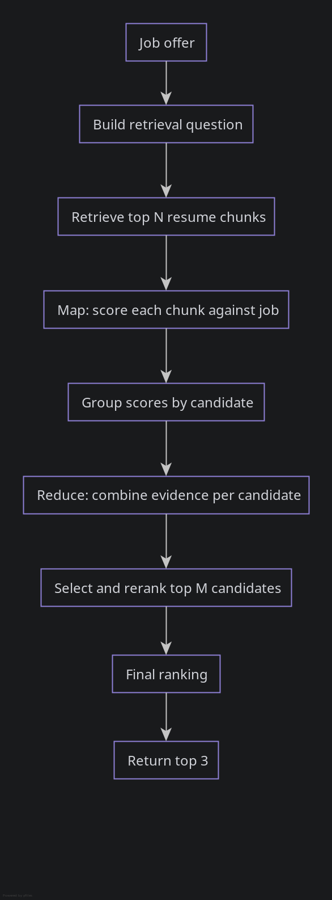

# Recruitment Agent

Recruitment Agent is a web application for recruiters to manage job offers, upload candidate
resumes, and find candidates whose experience best matches an open position. It combines semantic
retrieval over indexed resume content with an AI ranking pipeline and returns up to three
evidence-backed candidate matches.

## Features

- Browse, create, and edit job offers stored in MongoDB.
- Upload PDF resumes. The application extracts candidate email from the PDF, stores resume metadata
  in MongoDB, and retains the original PDF locally for download.
- Extract and normalize resume text, split it into chunks, create embeddings locally, and index the
  chunks in ChromaDB.
- Match resumes against a selected job offer and show up to three ranked candidates, with matched
  skills and relevant work experience.
- Download an uploaded resume through the application.
- Use a single-page frontend built with HTML, CSS, Bootstrap, and vanilla JavaScript.

## Architecture

The application is a Java 21 and Spring Boot service. Its static single-page frontend is served by
Spring Boot and calls REST endpoints under `/api`.

```text
Browser (static SPA)
        │ REST/JSON and multipart upload
        ▼
Spring Boot application
  ├── Controllers: HTTP endpoints and response/error mapping
  ├── Services: job-offer, resume, and candidate-matching workflows
  ├── MongoDB: job-offer and resume metadata
  ├── ChromaDB: resume chunks, embeddings, and retrieval
  └── OpenAI chat model: map evaluation and final ranking
```

The main backend responsibilities are grouped under `controller`, `service.joboffer`,
`service.resume`, and `service.matching`. Repositories and entities handle MongoDB persistence.
`ResumePdfIndexer` extracts and prepares PDF text, then writes vector documents to ChromaDB. The
embedding model runs locally through Spring AI Transformers; resume text is not sent to an external
embedding service. Candidate matching uses the configured OpenAI chat model for its map and
final-ranking stages.

### Spring AI components

Spring AI provides the document-processing, vector-store, embedding, and chat abstractions used by
the application:

- **`PagePdfDocumentReader`** reads uploaded PDFs into page-level `Document` objects so text and
  page boundaries can be processed consistently.
- **`DocumentTransformer` and `TokenTextSplitter`** normalize whitespace, then split resume text
  into configurable token-sized chunks. Chunking keeps retrieval focused and supports bounded
  evidence payloads later in ranking.
- **`VectorStore` backed by ChromaDB** stores and searches those chunks. ChromaDB provides semantic
  retrieval for a job-specific question and persists resume chunk metadata such as candidate email
  and document version. The `VectorStore` interface keeps application services decoupled from the
  concrete store client.
- **Spring AI Transformers embedding model** generates vector embeddings locally during indexing
  and semantic search. Keeping embedding local avoids sending resume text to an external embedding
  API.
- **`ChatClient` backed by Spring AI OpenAI chat model** runs the map evaluation and final shortlist
  reduction. The shared client sets the system prompt; each stage supplies its own prompt resource
  and structured response type. Application code validates candidate identity, score ranges, and
  evidence references after each model response.

The ranking path uses the `VectorStore` directly for retrieval, followed by explicit map and reduce
calls through `ChatClient`. It does not rely on a single retrieval-augmented advisor to perform the
whole ranking operation; keeping these stages explicit lets the application bound the candidate
pool and validate evidence between model calls.

## Application API

The main API routes are:

| Route                                    | Purpose                                               |
|------------------------------------------|-------------------------------------------------------|
| `GET /api/job-offers`                    | List job offers                                       |
| `POST /api/job-offers`                   | Create a job offer                                    |
| `PUT /api/job-offers/{id}`               | Update a job offer                                    |
| `POST /api/resumes`                      | Upload and index a PDF resume (`multipart/form-data`) |
| `GET /api/resumes/{candidateEmail}/file` | Download a retained resume PDF                        |
| `POST /api/candidate-matches`            | Retrieve and rank candidates for a job offer          |

## MapReduce and tiered candidate ranking pipeline

### Why this pipeline is necessary

Vector search returns resume chunks, not a clean, complete list of candidates. A candidate can have
multiple matching chunks, the retrieved pool can be much larger than the three results the product
returns, and some chunks can refer to an older resume version. Sending the full pool to one model
request would make input size and cost grow with the corpus, crowd relevant evidence out of the
model's context, and ask one response to both assess every candidate and make the final comparison.
That also makes it harder for the application to check each claim against the correct resume.

The MapReduce and tiered approach addresses those constraints directly: retrieval bounds the chunk
pool, evidence assembly groups current chunks under each candidate, and map batches bound the size
and concurrency of independent assessments. Application code sorts validated map scores and limits
the final model call to a small shortlist. The reducer receives the shortlisted candidates' complete
retrieved evidence (within a per-candidate budget), so it can compare trade-offs without receiving
the entire pool. Keeping chunk IDs and resume document versions through the stages lets the
application reject unsupported citations and stale evidence, while validating that the final answer
contains only shortlisted candidates. This makes model requests bounded and the ranking auditable;
it does not guarantee that a model's judgment is objectively correct.

### How it works

Candidate matching is split into bounded retrieval, map, and reduce stages.

1. **Retrieve broadly.** Query the vector store with the offer’s position, required skills,
   responsibilities, location, and working mode. Retrieve a configurable pool—perhaps 30–50 resume
   chunks—instead of only 3. The exact value should be tuned against vector store quality, latency,
   and model context limits.

2. **Map over chunks.** For each retrieved chunk, assess relevance to the job and extract only
   evidence present in that chunk: candidate identifier, skills, relevant experience, location, and
   work mode. Keep the vector similarity score as a retrieval signal; don’t treat it as the final
   match score.

3. **Group by candidate.** Use a stable candidate ID in document metadata, if available. Group
   chunks by that ID so multiple chunks from one resume don’t crowd out distinct candidates. If
   metadata lacks an ID, adding one at resume ingestion is a useful prerequisite.

4. **Reduce evidence per candidate.** Combine a candidate’s chunks, remove duplicates, and produce a
   compact evidence summary with source chunk references. Score each candidate against required
   criteria and nice-to-haves. Missing evidence should stay unknown rather than being treated as
   either a match or a mismatch.

5. **Use tiers to spend model effort selectively.** Apply inexpensive filtering or scoring first,
   then ask the model for a deeper structured evaluation of a smaller shortlist—say the top 10–15
   candidates. A final comparison pass can order that shortlist and return up to three candidates.
   Keep the required and preferred criteria distinct, and validate identities and evidence against
   the retrieved documents.

6. **Return three unique candidates.** Sort by the final evaluation, deduplicate by candidate
   ID/email, assign positions, then take the first three. Return fewer when fewer than three
   candidates have sufficient retrieved evidence; never fill empty slots by inventing candidates.

Map scores are internal selection values; they are not exposed as final match probabilities. A
failed batch or invalid final response fails the matching request rather than returning a partial
ranking.

Map batches use bounded concurrency. Candidate hydration searches currently run sequentially, so
retrieval latency can grow with the number of selected candidates and each candidate's Chroma query
latency.
<p style="text-align: center">
    
</p>

## Spec-Driven Development

The project uses Spec-Driven Development (SDD), with feature artifacts in `.codex/specs/`. The loop
has four phases:

1. **Requirements discovery:** Define the problem, scope, business rules, functional and
   non-functional requirements, error cases, and acceptance criteria in `01-requirements.md`. Review
   and approve requirements before design begins.
2. **Technical design:** Translate approved requirements into an implementation plan in
   `02-design.md`, including component responsibilities, data and API contracts, failure behavior,
   and how acceptance criteria will be verified. Review the design before implementation.
3. **Task breakdown:** Decompose the approved design into small, ordered, verifiable implementation
   steps in `03-tasks.md`. Each task identifies the relevant requirements and the evidence needed to
   consider it complete.
4. **Atomic execution:** Implement one task at a time against the requirements and design, add or
   update the corresponding tests, run relevant checks, and record completion evidence before
   proceeding. If implementation uncovers a gap, return to requirements or design and update the
   specification before changing behavior.

After execution, the project’s separate **Review Agent** activity compares the implementation and
tests with the approved requirements and design, reports gaps, and approves completion only when
acceptance criteria are supported by evidence. `.codex/AGENTS.md` and `.codex/prompts.md` document
the roles and workflow.

For example, the matching pipeline’s requirements and design describe evidence-grounded retrieval,
bounded map batches, shortlist reduction, output validation, configuration limits, and failure
behavior. The task list breaks that design into implementation steps, while focused tests and review
connect the delivered code to its acceptance criteria.

### Starting a feature with the multi-SDD script

The helper at `.codex/sdd-multi.sh` supports three commands:

```bash
./.codex/sdd-multi.sh list
./.codex/sdd-multi.sh init <feature-name>
./.codex/sdd-multi.sh bundle <feature-name> <phase>
```

For a new feature, choose a short directory name (for example, `candidate-notifications`) and
initialize its specification set:

```bash
./.codex/sdd-multi.sh init candidate-notifications
```

This creates `.codex/specs/candidate-notifications/` with `01-requirements.md`, `02-design.md`, and
`03-tasks.md`. Draft and approve the requirements first, then the design, then the ordered task
breakdown. Before working on a phase, bundle its context:

```bash
./.codex/sdd-multi.sh bundle candidate-notifications 1  # Requirements
./.codex/sdd-multi.sh bundle candidate-notifications 2  # Design
./.codex/sdd-multi.sh bundle candidate-notifications 3  # Tasks
./.codex/sdd-multi.sh bundle candidate-notifications 4  # Feature prompts
```

The bundle command combines `.codex/AGENTS.md` with the selected phase file and copies the result to
the clipboard when `pbcopy` or `xclip` is installed; otherwise, it prints the context to the
terminal. Phases 1–3 bundle the corresponding feature spec. Phase 4 bundles the shared
`.codex/prompts.md` playbook. Follow those prompts, implement tasks one at a time, and have the
reviewer check the results against the approved
requirements and design. Use `list` to see existing feature directories.

The helper resolves `.codex/AGENTS.md` and `.codex/specs/` relative to its own location, so it can
be invoked from the repository root or another working directory. New feature directories are
created under `.codex/specs/`.

## Run locally

### Prerequisites

- Java 21
- Maven (or use the included Maven wrapper if present)
- Docker
- An OpenAI API key for candidate ranking

### Start MongoDB and ChromaDB

From the repository root, start MongoDB with authentication and persistent local data:

```bash
mkdir -p data/mongodb data/chroma

docker run -d --name recruitment-mongodb \
  -p 27017:27017 \
  -v "$PWD/data/mongodb:/data/db" \
  -e MONGO_INITDB_ROOT_USERNAME=admin \
  -e MONGO_INITDB_ROOT_PASSWORD=secret_password \
  mongo:latest
```

The application connects using the MongoDB host, port, database, authentication database, username,
and password configured in `src/main/resources/application.properties`. The local Docker settings
above use `localhost:27017`, database `recruitment_agent`, authentication database `admin`, and the
shown `admin` credentials. If you change the container credentials or database, update those
individual application properties to match.

Start ChromaDB:

```bash
docker run -d --name recruitment-chroma \
  -p 8000:8000 \
  -v "$PWD/data/chroma:/chroma/chroma" \
  -e ANONYMIZED_TELEMETRY=False \
  chromadb/chroma:latest
```

By default, the application connects to ChromaDB at `http://localhost:8000`, using collection
`recruitment_resumes`. Set `CHROMA_HOST` and `CHROMA_PORT` to override the endpoint.

Check that both containers are running with `docker ps`. Start the application on the host so its
default `localhost` database endpoints resolve correctly.

### Configure and launch the application

Set the API key in the environment used to launch the process. It is needed for candidate matching;
browsing offers and uploading/indexing resumes use MongoDB and ChromaDB as described above.

```bash
export OPENAI_API_KEY='your-api-key'
```

Run with the Maven wrapper:

```bash
./mvnw spring-boot:run
```

Or, if Maven is installed:

```bash
mvn spring-boot:run
```

Open [http://localhost:9090/](http://localhost:9090/). The server port defaults to `9090`.

To stop the database containers:

```bash
docker stop recruitment-mongodb recruitment-chroma
```

### Useful configuration

Values below are configured in `src/main/resources/application.properties` and can be overridden
through Spring environment variables or properties.

| Setting                                                        | Default                     | Purpose                                     |
|----------------------------------------------------------------|-----------------------------|---------------------------------------------|
| `OPENAI_API_KEY`                                               | Empty                       | API key for candidate ranking chat requests |
| `CANDIDATE_MATCHING_MODEL`                                     | `gpt-5.6-sol`               | Chat model used for map and final ranking   |
| `CHROMA_HOST` / `CHROMA_PORT`                                  | `http://localhost` / `8000` | ChromaDB endpoint                           |
| `CANDIDATE_MATCHING_PIPELINE_RETRIEVAL_TOP_K`                  | `1200`                      | Maximum chunks used to discover candidates  |
| `CANDIDATE_MATCHING_PIPELINE_MAX_CANDIDATES`                   | `100`                       | Maximum distinct candidates evaluated       |
| `CANDIDATE_MATCHING_PIPELINE_MAP_BATCH_SIZE`                   | `3`                         | Candidates evaluated per map batch          |
| `CANDIDATE_MATCHING_PIPELINE_SHORTLIST_SIZE`                   | `3`                         | Candidates passed to final ranking          |
| `CANDIDATE_MATCHING_PIPELINE_MAX_CONCURRENCY`                  | `5`                         | Concurrent map requests                     |
| `CANDIDATE_MATCHING_PIPELINE_MAX_EVIDENCE_CHARS_PER_CANDIDATE` | `24000`                     | Retrieved evidence limit per candidate      |

Retained PDFs are stored under `${user.home}/data/recruitment-agent/resume/`. Resume chunking can be
adjusted with `RESUME_INDEXING_CHUNK_SIZE`, `RESUME_INDEXING_MIN_CHUNK_SIZE_CHARS`,
`RESUME_INDEXING_MIN_CHUNK_LENGTH_TO_EMBED`, `RESUME_INDEXING_MAX_NUM_CHUNKS`, and
`RESUME_INDEXING_KEEP_SEPARATOR`.

The candidate matching `ChatClient` uses Spring AI's `SimpleLoggerAdvisor` as a default advisor.
Prompt/completion observation logging is enabled, and the advisor logger is set to `DEBUG`; these
logs can contain full job and resume content, candidate contact details, and model responses.
Restrict access to application logs and avoid enabling these settings in environments where that 
data must not be recorded.

## Application Gaps

### Chat diagnostics can record candidate data

The current Spring AI observation settings and `SimpleLoggerAdvisor` DEBUG logger can write prompt
and completion payloads—including resume content, candidate contact details, and model responses—to
application logs. This conflicts with the ranking feature's privacy requirement not to log that
data.
Restrict log access and retention; the application is not compliant with that requirement until
logging is redacted or disabled.

### Resume replacement can leave inconsistent data

The upload path writes new vectors, saves MongoDB metadata, then deletes old vectors. If the MongoDB
save fails, the new vectors are rolled back; but if deleting old vectors fails, the upload still
reports success and leaves stale chunks. A crash between these operations can also leave MongoDB,
ChromaDB, and the retained PDF out of sync. See `ResumeUploadService.java`.

### Same-name candidates can overwrite retained PDFs

Files are named from candidate name, but resume identity is email. See `ResumeFileStorage.java`.
